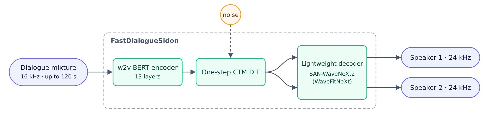

# FastDialogueSidon

[](https://huggingface.co/higurashi-ai/FastDialogueSidon)


[](https://arxiv.org/abs/2604.09344)


## Introduction

**FastDialogueSidon** is a fast one-step model for full-duplex two-speaker dialogue
separation and joint restoration: a raw 16 kHz mono mixture (telephone /
conversational audio, up to 120 s per window) goes in, two separated 24 kHz
speaker tracks come out. Every module — encoder, DiT head and decoder — is
trained for FastDialogueSidon. A single DiT step per window replaces
the 30 diffusion steps of [DialogueSidon](https://arxiv.org/abs/2604.09344),
and a **lightweight decoder** (a frame-rate SAN-WaveNeXt2 (WaveFitNeXt) latent decoder,
30 M parameters) replaces its DAC decoder. Running on fused GPU kernels, it is
**~100x faster** than the official DialogueSidon release run as-is, at
matching intelligibility.



Two interchangeable backends share the same weights and the same Python
interface (`separate`, `separate_batch`, `stream_files`):

- **[`triton/`](triton/README.md)** — Triton kernels around cuBLAS, no engine
  build, fp16 by default. Fastest and most accurate; **recommended**.
- **[`trt/`](trt/README.md)** — TensorRT 10 engines with a fused Triton
  attention plugin; per-GPU engine build.

## Quick Links

- [Release](#release)
- [Model](#model)
- [Backends](#backends)
- [Quick Start](#quick-start)
- [Evaluation](#evaluation)
- [Repository Layout](#repository-layout)
- [Acknowledgements](#acknowledgements)
- [Citation](#citation)
- [License](#license)

## Release

- **2026-10-27** — Initial release: an engine-free Triton backend (fp16,
  recommended; ~4700x real-time on H100) and a TensorRT backend sharing one
  runtime interface, with Apache-2.0 weights on
  [Hugging Face](https://huggingface.co/higurashi-ai/FastDialogueSidon).

## Model

| | |
|---|---|
| Weights | [higurashi-ai/FastDialogueSidon](https://huggingface.co/higurashi-ai/FastDialogueSidon) (fp32 safetensors, ≈1.73 GB, Apache-2.0) |
| Encoder | w2v-BERT 2.0 architecture, 13 layers, hidden 1024, `relative_key` attention (clamp −64…+8) |
| Head | CTM one-step DiT, 8 layers, hidden 768, RoPE, adaLN |
| Decoder | lightweight SAN-WaveNeXt2 (WaveFitNeXt) latent decoder (30.1 M params): 2 iterations, 8 frame-rate ConvNeXt blocks |
| Input / output | 16 kHz mono, any length 3.2-120 s → 2 × 24 kHz |

## Backends

| | **Triton** ([`triton/`](triton/README.md)) | **TensorRT** ([`trt/`](trt/README.md)) |
|---|---|---|
| Requirements | torch ≥ 2.8 with Triton | + TensorRT 10.16, per-GPU engine build |
| Default precision | fp16 operands, fp32 residual / norm / softmax / accumulate | fp16 encoder + DiT, bf16 decoder |
| 120 s window, H100 | **25.3 ms** | 32.3 ms |
| 15 s window, H100 | **3.7 ms** | 5.7 ms |
| Separated audio vs fp32 (SNR) | **30.6-35.7 dB** | 16.7-18.8 dB |
| Validated GPUs | H100 | H100, RTX PRO 6000 Blackwell, RTX 4090, RTX 5090 |

Both: variable length up to 120 s (10 s bucketed CUDA graphs), same-length
batching, overlapped file streaming. Longer recordings are chunked by the caller.

### Numerical accuracy

SNR (dB) of each backend's outputs against the fp32 PyTorch reference, given
the same input and noise; **higher means closer to the reference** (smaller
numerical error). Measured at three points of the pipeline: **conditioning**
(encoder output), **latents** (one-step DiT output fed to the decoder) and
**separated audio** (final waveforms, CallFriend 120 s × 5 windows).

| | conditioning | latents | separated audio |
|---|---|---|---|
| Triton fp16 (default) | 60.0 dB | 57.7 dB | 30.6-35.7 dB |
| Triton bf16 | 46.6 dB | 42.5 dB | 15.8-18.3 dB |
| TensorRT default | 52.6 dB | 49.0 dB | 16.7-18.8 dB |
| TensorRT all-bf16 | 38.8 dB | 26.0 dB | 9.9-12.9 dB |

Conditioning and latents: one 120 s window per row.

## Quick Start

```bash
git clone https://github.com/higurashi-ai/FastDialogueSidon && cd FastDialogueSidon
hf download higurashi-ai/FastDialogueSidon --local-dir weights/
```

**Triton** (no build step):

```bash
cd triton && pip install -e .
source configs/env.example.sh
python scripts/run.py --bundle ../weights --wav dialogue.wav --output-dir out/
```

**TensorRT**:

```bash
cd trt && pip install -e .
source configs/env.example.sh        # NVIDIA_TF32_OVERRIDE=0 (required)
python scripts/build_engines.py --bundle ../weights \
  --engine-dir artifacts/$(hostname)-trt10 --onnx-dir /tmp/fds-onnx
python scripts/run.py --engine-dir artifacts/$(hostname)-trt10 \
  --wav dialogue.wav --output-dir out/
```

Python (same interface on both backends):

```python
from fds_triton.runtime import TritonPipeline, load_waveform    # Triton
pipe = TritonPipeline("weights/")
# from fastdialoguesidon.runtime import TRTPipeline             # TensorRT
# pipe = TRTPipeline("trt/artifacts/<host>-trt10")

audio = pipe.separate(load_waveform("dialogue.wav"))  # [2, samples] @ 24 kHz
```

## Evaluation

### Speed

Against the original **DialogueSidon** — official release run as-is (fp32
PyTorch, DPM-Solver++ 30 steps + DAC): per-window wall clock recorded by each
system's benchmark runner on the benchmark inputs below (H100, batch 1):

| | DialogueSidon | FastDialogueSidon (Triton fp16) | speed-up |
|---|---|---|---|
| OpenDialog, 30 s windows | RTF 0.0178 (0.53 s / window) | RTF 2.07e-4 (6.2 ms) | **86x** |
| CallFriend, 120 s windows | RTF 0.0222 (2.67 s / window) | RTF 2.07e-4 (24.8 ms) | **107x** |

Where the speed-up comes from (single DiT step vs lightweight decoder):
see the [Triton README](triton/README.md#results-h100-sxm-batch-1-cuda-graphs).

### Benchmark

The protocol follows the evaluation of the DialogueSidon paper
([Nakata et al., 2026](https://arxiv.org/abs/2604.09344), Sec. 4.1), with
these deviations: CallFriend sessions are cropped to **120 s** (the paper uses
20 s) and OpenDialog uses 100 English sessions of exactly 30 s;
intelligibility is scored with **Qwen3-ASR-1.7B** instead of Whisper
large-v3 (p-CER for CallFriend against transcripts of the clean reference
tracks, WER for OpenDialog against the human transcripts; speaker permutation
by lowest ASR error). NISQA v2, DNSMOS P.808, WavLM speaker similarity and
Silero VAD accuracy as in the paper. Both systems run on the same inputs.
Neither CallFriend nor OpenDialog is used for training; both serve only as test sets.

**OpenDialog** (English, 100 × 30 s)

| | WER (%) ↓ | DNSMOS ↑ | NISQA ↑ |
|---|---|---|---|
| DialogueSidon | 13.21 | **3.327** | **3.757** |
| FastDialogueSidon (Triton fp16) | **10.80** | 3.303 | 3.491 |

**CallFriend** (5 languages × 20 × 120 s)

| p-CER (%) ↓ | de | es | fr | ja | zh | all |
|---|---|---|---|---|---|---|
| DialogueSidon | 11.56 | **15.39** | **21.02** | 16.36 | 20.93 | 16.54 |
| FastDialogueSidon (Triton fp16) | **11.47** | 16.89 | 21.25 | **14.49** | **19.46** | **16.52** |

| | DNSMOS ↑ | NISQA ↑ | speaker sim. ↑ | VAD acc. ↑ |
|---|---|---|---|---|
| DialogueSidon | 3.293 | **3.626** | 0.941 | **0.931** |
| FastDialogueSidon (Triton fp16) | **3.294** | 3.395 | **0.943** | 0.929 |

Intelligibility matches or beats the 30-step original (run as-is: ~100x the
speed); the NISQA gap comes from the vocoder (SAN-WaveNeXt2 (WaveFitNeXt) here vs. the
original DAC decoder).

## Repository Layout

```
FastDialogueSidon/
├── README.md            this overview
├── assets/              architecture diagram
├── triton/              Triton + cuBLAS backend (package fds_triton)
│   ├── README.md        kernels, precision, benchmarks, rejected variants
│   ├── src/fds_triton/  kernels.py, model.py, runtime.py, reference/
│   ├── scripts/         run / bench / verify
│   ├── tools/           microbench, seed sweep, benchmark runner + comparison
│   └── tests/           GPU kernel unit tests
└── trt/                 TensorRT backend (package fastdialoguesidon)
    ├── README.md        engines, precision, variable length, GPU support
    ├── docs/SETUP.md    environment recipe and pitfalls
    ├── src/fastdialoguesidon/
    ├── scripts/         build_engines / run / bench_e2e / bench_torch_flex
    └── tools/           benchmark runner, resample benchmark
```

## Acknowledgements

We thank the authors and maintainers of the following projects, on which
this work builds:

- [DialogueSidon](https://arxiv.org/abs/2604.09344) /
  [Sidon](https://github.com/sarulab-speech/Sidon/) — the task definition and
  the research codebase our model definitions are adapted from
- [CTM](https://github.com/sony/ctm) — Consistency Trajectory Models
- [BigVSAN](https://github.com/sony/bigvsan) — SAN-based vocoder
- [wavefit-pytorch](https://github.com/yukara-ikemiya/wavefit-pytorch) —
  the WaveFit/WaveFitNeXt implementation vendored here
- [Triton](https://github.com/triton-lang/triton) and
  [TensorRT](https://github.com/NVIDIA/TensorRT)

## Citation

The FastDialogueSidon technical report is coming soon:

```bibtex
@misc{kotoge2026fastdialoguesidon,
  title  = {FastDialogueSidon (technical report)},
  author = {Kotoge, Rikuto},
  year   = {2026},
  note   = {Technical report, coming soon}
}
```

Please also cite DialogueSidon, the task and benchmark protocol this work
builds on:

```bibtex
@inproceedings{nakata2026dialoguesidon,
  title={DialogueSidon: Recovering Full-Duplex Dialogue Tracks from In-the-Wild Dialogue Audio},
  author={Nakata, Wataru and Saito, Yuki and Yamauchi, Kazuki and Tsunoo, Emiru and Saruwatari, Hiroshi},
  booktitle={Proceedings of the 27th Annual Meeting of the Special Interest Group on Discourse and Dialogue},
  pages={1--12},
  year={2026}
}
```

## License

- **Code and model weights**: [Apache License 2.0](LICENSE). Parts derived
  from MIT-licensed projects (Sidon, wavefit-pytorch) keep their notices in
  [THIRD_PARTY_NOTICES.md](THIRD_PARTY_NOTICES.md).
- The TensorRT backend needs NVIDIA TensorRT, which is installed separately
  under NVIDIA's own license.
